# Mapa de Navegación y Jerarquía de Vistas | Contact LESSSO

Fecha de auditoría: 2026-10-28.
Estado: Definido y aprobado.

```mermaid
flowchart TD
    App["Contact | LESSSO"]
    App --> M1["1. Inicio (Dashboard)"]
    App --> M2["2. CRM LESSSO"]
    App --> M3["3. Agenda y Operación"]
    App --> M4["4. Comunicaciones"]
    App --> M5["5. Bóveda"]
    App --> M6["6. Finanzas Personales"]
    App --> M7["7. Taller"]
    App --> M8["8. Sistema (Núcleo)"]

    M2 --> CRM1["Captación y OpenStreetMap"]
    M2 --> CRM2["Pipeline de Prospectos"]
    M2 --> CRM3["Propuestas Comerciales"]
    M2 --> CRM4["Ficha de Clientes"]
    M2 --> CRM5["Ventas, Cobros y Facturas"]

    M3 --> AG1["Calendario Unificado"]
    M3 --> AG2["Tareas y Checklists"]
    M3 --> AG3["Bitácora de Visitas y Tiempo"]
    M3 --> AG4["Módulo de Pentesting"]

    M4 --> COM1["Bandeja Unificada de Mensajes"]
    M4 --> COM2["Plantillas Asistidas"]
    M4 --> COM3["WhatsApp (Modo Manual y Configuración)"]
    M4 --> COM4["Telegram Bot"]

    M5 --> VLT1["Cuentas de Correo y Recuperación"]
    M5 --> VLT2["Plataformas y Credenciales"]
    M5 --> VLT3["Contraseñas y TOTP"]
    M5 --> VLT4["Recursos Seguros y Notas"]
    M5 --> VLT5["Nivel de Seguridad y Filtraciones"]

    M6 --> FIN1["Gastos y Categorías"]
    M6 --> FIN2["Tarjetas y Medios de Pago (Opción B)"]
    M6 --> FIN3["Deudas y Calendario de Pagos"]
    M6 --> FIN4["Presupuestos y Reportes Mensuales"]

    M7 --> TAL1["Creatividad (Lienzo y Diagramas)"]
    M7 --> TAL2["Código (Variables de Entorno, Proyectos)"]
    M7 --> TAL3["Utilidades (Generador de Claves, Hashes)"]

    M8 --> SYS1["Mapa de Conexiones"]
    M8 --> SYS2["Historial de Actividad y Auditoría"]
    M8 --> SYS3["Configuración Modular y Catálogos"]
    M8 --> SYS4["Usuarios, Roles y Permisos"]
    M8 --> SYS5["Estado del Sistema y Requisitos"]
    M8 --> SYS6["Papelera y Bajas Lógicas"]
```

## Atajos de Teclado y Accesibilidad
- `Ctrl + K`: Paleta de comandos global para búsqueda y navegación directa.
- `Alt + 1` a `Alt + 8`: Acceso directo a cada uno de los 8 módulos principales.
- `Esc`: Cierra modales y paneles laterales volviendo el foco al elemento anterior.
- Navegación por tabulador (`Tab` / `Shift + Tab`) con indicador visible en dorado oscuro `#A98242`.
