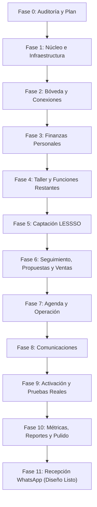

# Plan de Migración y Evolución Modular | Contact LESSSO

Fecha de auditoría: 2026-10-28.
Estado: Aprobado para ejecución fase por fase.

---

## 1. Estrategia de Migración No Destructiva
1. **Aditividad Estricta**: Ninguna migración de base de datos elimina columnas o tablas históricas mientras existan lecturas activas.
2. **Compatibilidad Inversa de Rutas**: Los endpoints `/api/v1/*` actuales mantienen sus firmas de entrada y salida o redirigen internamente a los nuevos controladores modulares.
3. **Aislamiento por Esquemas y Servicios**:
   - Módulo Núcleo (Sistema): esquemas de usuarios, roles, sesiones, auditoría, parámetros y cola de trabajos.
   - Módulo Bóveda: esquemas de credenciales, correos, secretos y notas seguras.
   - Módulo Finanzas: esquemas de gastos, categorías, presupuestos, tarjetas (Opción B) y deudas.
   - Módulo CRM LESSSO: esquemas de prospectos, clientes, propuestas, ventas y cobros.
   - Módulo Agenda y Operación: esquemas de eventos, tareas, checklists, visitas y pentesting.
   - Módulo Comunicaciones: esquemas de hilos, plantillas, lista de no contactar y cola de salida.
   - Módulo Taller: esquemas de utilidades, herramientas y proyectos.

---

## 2. Secuencia de Ejecución de Fases

---

## 3. Plan de Reversión (Rollback) por Fase
- **Fase 1**: Si la migración de sesiones o la configuración modular falla, se reactiva el modo de sesión en memoria transitorio y se restaura el archivo previo de Compose.
- **Fase 2**: La rotación de claves y cifrado se ejecuta dentro de transacciones de base de datos; si un solo registro falla al descifrar o recifrar, se invoca `ROLLBACK` atómico.
- **Fase 3**: Los registros de gastos y tarjetas se crean en tablas nuevas con copia de los datos existentes en `BillingRecord` y `PaymentMethod`. La tabla origen no se destruye.
- **Fase 4 a 8**: Cada nuevo módulo se monta sobre rutas dedicadas (`/api/v1/crm/*`, `/api/v1/agenda/*`, `/api/v1/comms/*`, etc.) manteniendo activas las rutas anteriores de `/api/v1/prospects` y `/api/v1/finances` como envoltorios de compatibilidad.
